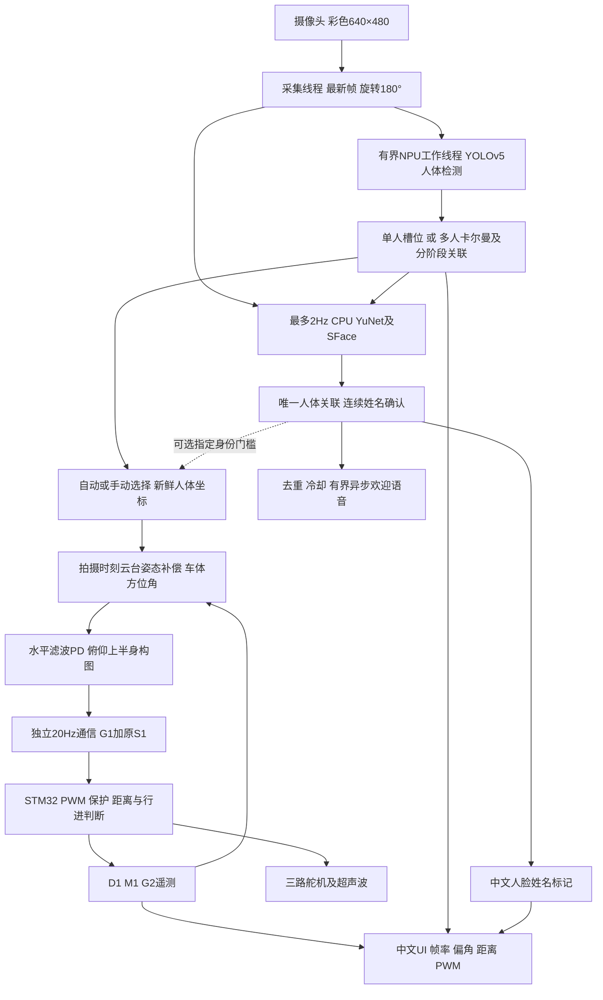

# 算法实现、线程与性能

## 数据流



## 人体与编号

`single_person.py` 在唯一真实高分人体连续满足帧数/时间及几何条件后使用01槽位，减少单人重复分配编号。它不承诺生物身份一致。多人采用 `body_identity.py` 的运动预测、分阶段匹配、HSV/梯度外观与受控更新；短时轨迹暂存、低分候选保关联，歧义时停止有效控制。可选OSNet接口保留，本副本不附OSNet模型，也未默认启用。

NPU人体检测高阈值0.35、低候选0.10。低候选不意味着可直接控制；有效控制要求真实新鲜观测以及当前锁定状态。`inference_worker.py` 保证模型创建、推理和释放在同一线程，最多一个在途任务；检测框一直与该拍摄帧绑定。过期帧不靠修改时间戳成为新数据。

## 云台为何能跟随

水平跟随使用人体框中心相对画面中线的误差，结合拍摄时刻估计的云台角，进行滤波PD、有限预测、转速/加速度约束和限位。以640像素画宽归一化的保持/重启阈值分别3/5像素，减少居中抖动。三路方向均沿用现场核对后的 `direction=-1`，不要仅凭截图左右再翻转。

俯仰不是追头顶单点，而是按人体框上方60%区域构图，期望构图中心在画高42%附近，并在近距离保护顶部余量。它是人体框比例启发式，不是骨骼关键点估计，人体被严重裁切时仍需先调整拍摄距离。

相对车体角并不是简单把云台PWM等同前轮PWM：先由像素光线和拍摄时刻云台姿态求车体方位，完成实测标定后才能结合距离、轴距、相机安装偏移计算前轮角。当前10μs/°和视场值为沿用的工程估计，`calibration_confirmed=false`，未提供可确认的整车转向标定。

## 人脸不挤占主循环的方式

`face_worker.py` 使用独立单线程、最多一个在途请求，默认2Hz；忙时不堆积新图像。YuNet缩小图做人脸检测，SFace只计算最多三张有效脸；原图及人体令牌随任务保存，输出不携带特征/照片。主线程只轮询已完成结果，不等待人脸推理。

这减少主循环等待，但不能消除CPU竞争：图像预处理、SFace、中文UI、音频仍占CPU/内存带宽。人脸实际处理可能低于2Hz，延迟超过0.9秒结果会被舍弃，优先避免旧身份误绑定。可在命令末尾添加 `--face-hz 1` 降低频率，或使用 `--mode body-only` 做同场对比。

语音通过另一线程执行本机合成，队列有界；故障只改变UI状态与日志，普通人体模式继续运行。指定身份模式在姓名失效时撤销有效控制。

## 怎样看真实FPS

请区分相机采集FPS、人体处理FPS、人脸识别频率和串口20Hz。串口20Hz不代表相机或模型20FPS。UI“实际处理帧率”和指标 `steady_wall_fps` 才用于评价整条视觉链。

新副本尚无板端性能验收。既有现场周期约6.91～15.78FPS，并未证明20FPS；不能因为本机单元测试快就承诺板端达标。

建议固定光线和人物，关闭其他高负载程序，分别测各60秒：

```bash
bash run.sh --mode body-only --max-seconds 60 --metrics-json logs/body_only.json
bash run.sh --mode preview --max-seconds 60 --metrics-json logs/face_welcome.json
```

比较实际处理FPS、相机FPS、p95帧龄、NPU前/后处理、人脸耗时及有效跟踪比例，不只比峰值数字。画质至少保持彩色640×480可看清人体与脸，禁止通过黑画面、空场景、重复旧帧或关闭跟踪来“达到20FPS”。若差距主要来自相机曝光，要先补光/检查采集；若来自CPU，再调整人脸频率、UI刷新或模型结构。
